<p align="center">
  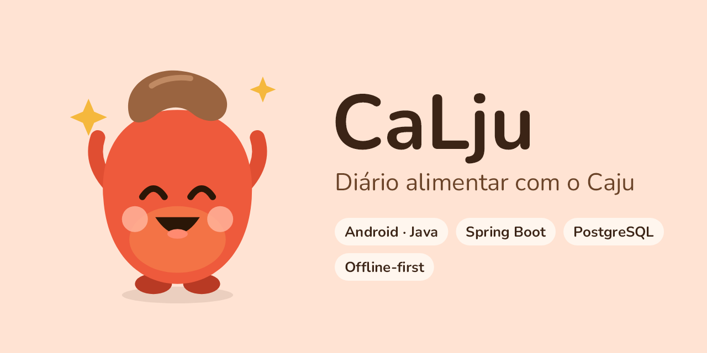
</p>

<p align="center">
  
  
  
  
  
  
</p>

**CaLju** é um diário alimentar para Android: você conta ao Caju o que comeu — *"arroz 150"*,
*"2 bananas"* — e ele calcula calorias, macronutrientes e micronutrientes do dia com a
Tabela Brasileira de Composição de Alimentos (TACO). Funciona **100% offline**; um backend
opcional em Spring Boot oferece conta, backup e sincronização entre aparelhos.

> Princípio do projeto: **facilitar o registro alimentar, não transformá-lo em mais uma tarefa.**

<p align="center">
  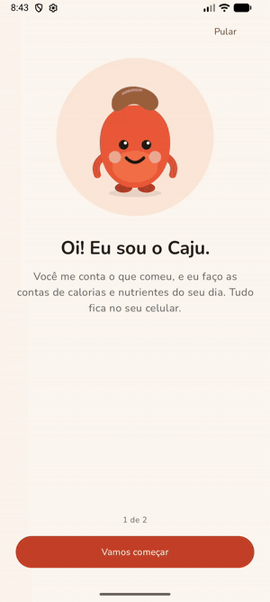
  <br>
  <sub>Boas-vindas, registro por texto, painel animado, micronutrientes, histórico e tema escuro.
  <a href="docs/imagens/demo.mp4">Vídeo em MP4</a>.</sub>
</p>

## Telas

| Diário | Sugestões ao digitar | Quantidade | Micronutrientes |
|:---:|:---:|:---:|:---:|
| 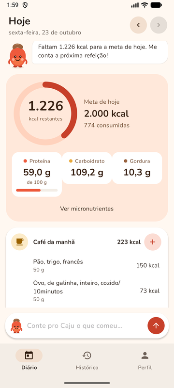 | 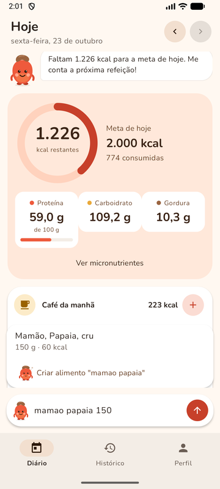 | 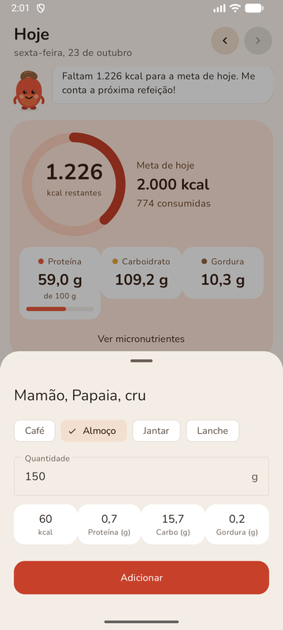 | 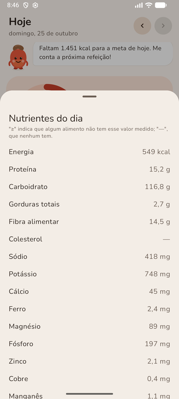 |
| **Boas-vindas** | **Histórico** | **Alimento da embalagem** | **Tema escuro** |
| 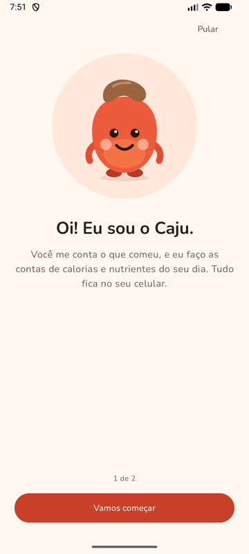 | 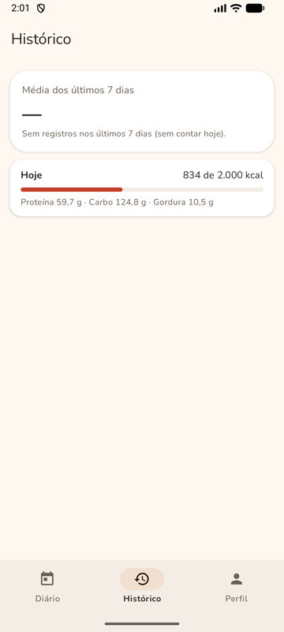 | 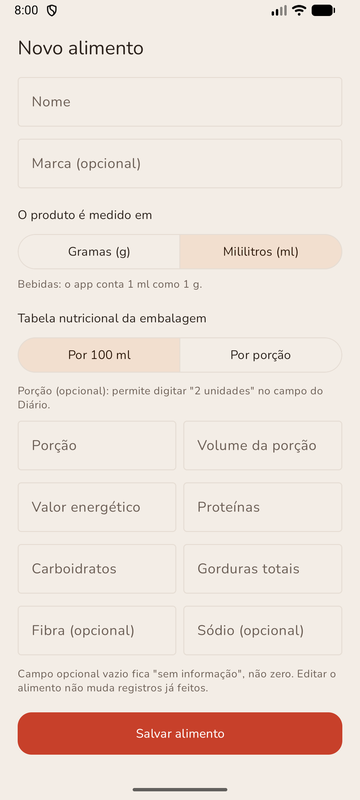 | 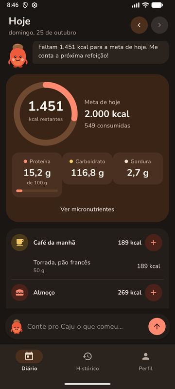 |

## Funcionalidades

- **Registro em linguagem natural:** "arroz 150", "150 g de arroz", "2 bananas" (usa a porção
  caseira do IBGE), "suco 200 ml"; sugestões a cada letra, sem internet.
- **Painel do dia** com anel de calorias e macros animados, metas com data de vigência e
  micronutrientes sob demanda.
- **Diário por refeição** (café, almoço, jantar, lanche), edição, remoção com "Desfazer" e
  histórico com a média da semana.
- **Refeições prontas** reutilizáveis e **alimentos da embalagem** (tabela por 100 g/ml ou
  por porção, convertida automaticamente).
- **O Caju**, mascote que conversa conforme o dia, sem julgamento e sem alarmes.
- **Conta opcional** (cadastro por e-mail com código) com backup e sincronização entre
  aparelhos; o login com Google já está pronto no backend.
- Tema claro e escuro, fonte grande, TalkBack.

## Destaques técnicos

| Área | O que foi feito |
|---|---|
| **Offline-first** | Room (SQLite) como fonte da verdade; o servidor é opcional. Os nutrientes de cada registro são **copiados no momento do consumo** (snapshot): editar um alimento depois não altera o passado. Valores em `BigDecimal`, distinguindo zero, traço e desconhecido. |
| **Sincronização** | Protocolo próprio: envio por registro com **versão otimista** (409 em conflito) e recebimento incremental por **cursor** (`change_seq` gerado por trigger no PostgreSQL). Conflitos nunca sobrescrevem em silêncio: refeições viram cópia "(conflito)" e registros do diário são resolvidos pelo usuário. Reenvio idempotente e tolerante a quedas no meio. WorkManager em segundo plano. |
| **Segurança** | JWT de acesso (15 min) + **refresh token opaco rotativo com detecção de reutilização** (revoga a família de sessões); senhas com **Argon2id**; login com Google validado por JWKS; limitação de tentativas com `429 + Retry-After`; respostas que não revelam se um e-mail tem conta; testes de IDOR; sessão no app cifrada com **AES-GCM no Android Keystore**; padrão "negar tudo" no Spring Security; segredos só em variáveis de ambiente. |
| **Dados** | Ferramenta própria (`tools/catalog-builder`) converte a planilha oficial da TACO e as porções do IBGE em um catálogo versionado de 596 alimentos com códigos de nutrientes INFOODS. |
| **Acessibilidade** | Testes automáticos com o *Accessibility Test Framework* do Google (área de toque, contraste, rótulos) no tema claro e escuro; layout adaptado para fonte em 200%; descrições para TalkBack. |
| **Qualidade** | 305 testes: unitários, Room com banco real, MockWebServer, Espresso e integração do backend com **Testcontainers** (PostgreSQL real). Migrações de banco testadas desde a versão 1. Lint sem erros. |
| **Entrega** | APK de release com R8 e **nenhuma permissão** pedida ao usuário; backend em imagem Docker de produção (usuário sem privilégios, perfil `prod`, IP real atrás de proxy); exclusão de conta pela web. |

## Arquitetura

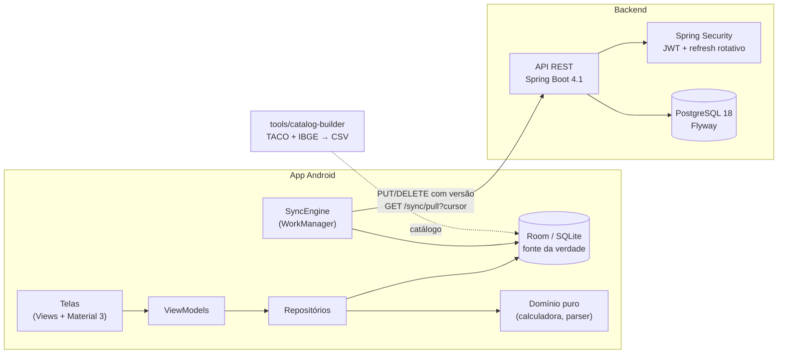

| Parte | Tecnologias |
|---|---|
| App (`android/`) | Java 17, Views/XML + Material 3, MVVM, Room, WorkManager, Retrofit + OkHttp, Android Keystore, injeção de dependência manual |
| Backend (`backend/`) | Java 17, Spring Boot 4.1, Spring Security (resource server JWT), JPA/Hibernate, Flyway, PostgreSQL 18, Testcontainers |
| Ferramentas (`tools/`) | Leitor da planilha da TACO e gerador do catálogo |
| Infraestrutura | Docker Compose (PostgreSQL + Mailpit para e-mails de teste), Dockerfile de produção |

Modelo de dados, protocolo de sincronização, decisões de segurança e design estão em
[docs/arquitetura.md](docs/arquitetura.md).

### Números

| Módulo | Código (linhas) | Testes (linhas) | Testes |
|---|---:|---:|---:|
| App Android | 7.589 | 3.153 | 103 locais + 85 no emulador |
| Backend | 3.168 | 1.679 | 86 de integração |
| Catalog-builder | 527 | 364 | 31 |

<sub>Linhas não vazias de Java, contadas em outubro de 2026.</sub>

## Estrutura do repositório

```
Calju/
├── android/   app Android (domain → data → ui)
├── backend/   API Spring Boot (auth, account, goal, food, meal, diary, sync)
├── tools/     catalog-builder: gera o catálogo a partir da TACO e do IBGE
├── data/      fontes oficiais (data/fontes) e catálogo gerado (data/catalog)
└── docs/      arquitetura, fontes de dados, autoria, INPI e imagens
```

## Como executar

<details>
<summary><b>Pré-requisitos</b></summary>

- JDK 17
- Docker Desktop (Docker Compose v2)
- Android SDK (somente para o app)

O Maven não precisa estar instalado: o projeto usa o Maven Wrapper (`mvnw`).
</details>

<details>
<summary><b>Banco de dados e e-mail de desenvolvimento</b></summary>

```powershell
Copy-Item .env.example .env   # depois defina POSTGRES_PASSWORD e CALJU_JWT_SECRET no .env
docker compose up -d
docker compose ps             # aguarde o estado "healthy"
```

O `docker compose` também sobe o **Mailpit**, um servidor de e-mail falso: os e-mails do
backend (códigos de confirmação) não saem para a internet e aparecem em http://localhost:8025.
</details>

<details>
<summary><b>Backend</b></summary>

O backend exige `CALJU_JWT_SECRET` no `.env` (segredo que assina os tokens). O login com
Google só funciona com `CALJU_GOOGLE_CLIENT_ID` (ID do cliente OAuth do tipo Web, criado no
Google Cloud); sem ele, `/api/v1/auth/google` responde 503 e o resto funciona normalmente.
Para gerar um valor aleatório de 32 bytes no PowerShell:

```powershell
$b = New-Object byte[] 32; [Security.Cryptography.RandomNumberGenerator]::Create().GetBytes($b); [Convert]::ToBase64String($b)
```

```powershell
cd backend
.\mvnw test               # testes (usam Testcontainers; o Docker precisa estar rodando)
.\mvnw spring-boot:run    # sobe a API em http://localhost:8080
```

Verificação: `http://localhost:8080/actuator/health` deve responder `{"status":"UP", ...}`.
Página pública de exclusão de conta: `http://localhost:8080/excluir-conta.html`.

**Imagem Docker de produção** (o backend ainda não está publicado):

```powershell
docker build -t calju-backend backend
```

Roda no perfil `prod`, como usuário sem privilégios, e exige as variáveis `POSTGRES_HOST`,
`POSTGRES_DB`, `POSTGRES_USER`, `POSTGRES_PASSWORD`, `CALJU_JWT_SECRET`, `MAIL_HOST`,
`MAIL_USERNAME`, `MAIL_PASSWORD` e `MAIL_FROM` (opcionais: `POSTGRES_PORT`, `MAIL_PORT`,
`CALJU_GOOGLE_CLIENT_ID`). O e-mail exige TLS; o HTTPS fica num proxy reverso, e o IP real do
cliente é lido do `X-Forwarded-For` só quando a conexão vem da rede interna.
</details>

<details>
<summary><b>App Android</b></summary>

No Android Studio, abra a pasta `android/`. Pela linha de comando:

```powershell
cd android
.\gradlew testDebugUnitTest            # testes locais (sem emulador)
.\gradlew installDebug                 # instala no emulador ou celular conectado
.\gradlew connectedDebugAndroidTest    # testes no emulador
```

A versão de desenvolvimento procura o backend em `10.0.2.2:8080` (o computador, visto do
emulador).
</details>

<details>
<summary><b>APK de release (versão final)</b></summary>

A versão final é 100% offline: sem conta, sem sincronização e sem permissão de internet,
até existir um servidor de produção. Ela é assinada com uma chave que **nunca** entra no
repositório; guarde uma cópia de segurança da chave e da senha fora do computador.

1. Criar a chave (uma vez só), fora do repositório. O `keytool` vem com o JDK e pede a senha:

   ```powershell
   New-Item -ItemType Directory -Force $HOME\.android-keys
   keytool -genkeypair -v -keystore $HOME\.android-keys\calju-release.jks -storetype PKCS12 `
       -alias calju -keyalg RSA -keysize 4096 -validity 10000
   ```

2. Informar ao Gradle onde está a chave, em `%USERPROFILE%\.gradle\gradle.properties`:

   ```properties
   CALJU_RELEASE_STORE_FILE=C:/Users/SEU_USUARIO/.android-keys/calju-release.jks
   CALJU_RELEASE_STORE_PASSWORD=a senha escolhida no passo 1
   CALJU_RELEASE_KEY_ALIAS=calju
   CALJU_RELEASE_KEY_PASSWORD=a mesma senha
   ```

3. Gerar e conferir o APK:

   ```powershell
   cd android
   .\gradlew assembleRelease
   & "$env:LOCALAPPDATA\Android\Sdk\build-tools\36.0.0\apksigner.bat" verify --print-certs `
       app\build\outputs\apk\release\app-release.apk
   ```

No Brasil, desde 30/09/2026, apps cujo nome de pacote não está registrado deixam de ser
instaláveis em aparelhos certificados. Para distribuir a outras pessoas, registre o pacote
`io.github.lucaslimacelino_dev.calju` no Android Developer Console (a conta de distribuição
limitada é gratuita e vale para até 20 aparelhos) com o SHA-256 da chave, mostrado por
`keytool -list -v -keystore $HOME\.android-keys\calju-release.jks`.
</details>

<details>
<summary><b>Catálogo de alimentos</b></summary>

Gerado a partir da planilha oficial da TACO (ver [docs/fontes-de-dados.md](docs/fontes-de-dados.md)):

```powershell
cd tools\catalog-builder
.\mvnw test package
java -cp target\classes io.github.lucaslimacelino_dev.calju.catalog.Main ..\..\data\fontes\taco\taco-4a-edicao-2011.xlsx ..\..\data\fontes\ibge\porcoes-unidade.csv ..\..\data\catalog
```
</details>

## Roadmap

- [x] Diário offline, metas, refeições prontas, alimentos personalizados, histórico
- [x] Backend com conta, login com Google, sincronização e resolução de conflitos
- [x] Acessibilidade, tema escuro, unidade ml, APK de release
- [ ] Login com Google no app
- [ ] Servidor de produção (conta e backup na versão final)
- [ ] Publicação na Google Play
- [ ] Registro no INPI ([guia](docs/inpi/README.md))

## Fontes de dados e créditos

- **Composição dos alimentos:** NÚCLEO DE ESTUDOS E PESQUISAS EM ALIMENTAÇÃO – NEPA/UNICAMP.
  *Tabela brasileira de composição de alimentos – TACO.* 4. ed. rev. e ampl. Campinas: NEPA-UNICAMP, 2011.
- **Porções caseiras:** IBGE. *Pesquisa de orçamentos familiares 2008-2009: tabela de medidas
  referidas para os alimentos consumidos no Brasil.* Rio de Janeiro: IBGE, 2011.
- **Fonte:** Nunito (The Nunito Project Authors), SIL Open Font License 1.1.
- **Ícones:** Material Icons (Google), Apache License 2.0.

O CaLju não é um dispositivo médico e não substitui a orientação de nutricionista ou médico.

## Autoria

Desenvolvido por **Lucas Lima Celino**, estudante de Ciência da Computação na Universidade
Federal de Sergipe (UFS).

O projeto foi construído com apoio de um assistente de IA, sob direção, decisões e revisão do
autor. O que foi feito com esse apoio está registrado, fase a fase, em
[docs/autoria.md](docs/autoria.md).

## Licença

Software proprietário — todos os direitos reservados. O código está visível para fins de
portfólio; uso, cópia ou redistribuição exigem autorização do autor. Ver [LICENSE](LICENSE).

---

<details>
<summary><b>English summary</b></summary>

**CaLju** is an offline-first food diary for Android. Users type what they ate in plain
Portuguese ("arroz 150", "2 bananas") and get calories, macros and micronutrients from the
Brazilian food composition table (TACO). Highlights: Room as the source of truth with
per-entry nutrient snapshots; a custom sync protocol (optimistic versioning, cursor-based
pull driven by a PostgreSQL trigger, explicit conflict resolution) over a Spring Boot 4.1
backend; JWT access tokens with rotating refresh tokens and reuse detection, Argon2id,
rate limiting and Google sign-in; Android Keystore AES-GCM session storage; automated
accessibility checks; 305 tests including Testcontainers integration tests.
</details>
